# Evolv Regression Hub: user guide

The Hub runs regression suites against a branch or release and compares every result with an
approved **baseline**. When something differs, it shows you the exact sheet, row and column, and
lets you either accept the change as the new baseline or treat it as a defect.

**Before you start, two things to know about this version:**

- **Runs are simulated.** The Hub does not yet run real builds or query Oracle. Results are
  generated per branch so that you can use and learn the full workflow. The yellow
  **Simulated runner** label at the bottom left is a reminder of this.
- **There is no login.** Anyone who can open the app can use it. When you change a baseline, you
  type your name and it is recorded.

To open the app, go to the address your team gave you (on your own computer: http://localhost:8000).

## Words used in the app

| Word | Meaning |
| --- | --- |
| Suite | One regression: an ordered list of steps plus the checks made at the end. It matches one build folder. |
| Step | One action in a suite, such as running setup SQL, loading a data zip or running a job. |
| Test point | One check: an Oracle query and the rows it is expected to return. It comes from one `r` sheet of a validation workbook. |
| Checkpoint | A "validate" step. It groups the test points from one validation workbook. |
| Baseline | The approved expected rows for a test point. Every change creates a new version (v1, v2, …). |
| Key columns | The columns that identify a row, such as a loan ID. Rows are matched on these, so row order never causes a failure. |
| Run | One execution of a suite on a branch or release. |
| Flaky | A test point that passes and fails on the same branch with the same baseline. |

## The menu

The dark bar on the left takes you to the six areas of the app.

| Menu item | Use it to |
| --- | --- |
| Dashboard | See overall health at a glance |
| Suites | Create, import and edit suites |
| Catalogue | Find and manage test points |
| Runs | Start runs and open their results |
| Build A vs B | Compare two runs with each other |
| Baselines | See who changed a baseline, and undo a change |

---

## 1. Dashboard

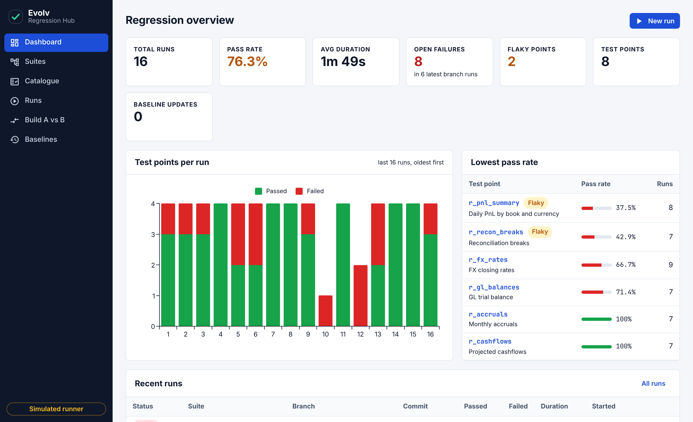

- The **boxes at the top** show totals: runs, pass rate, average duration, open failures, flaky
  test points, test points and baseline updates. **Open failures** counts what is still failing in
  the most recent run of each suite and branch.
- **Test points per run** shows green (passed) and red (failed) for each recent run. Click a bar to
  open that run.
- **Lowest pass rate** lists the test points that fail most often.
- **Recent runs** lists the latest runs. Click a row to open it.

## 2. Suites

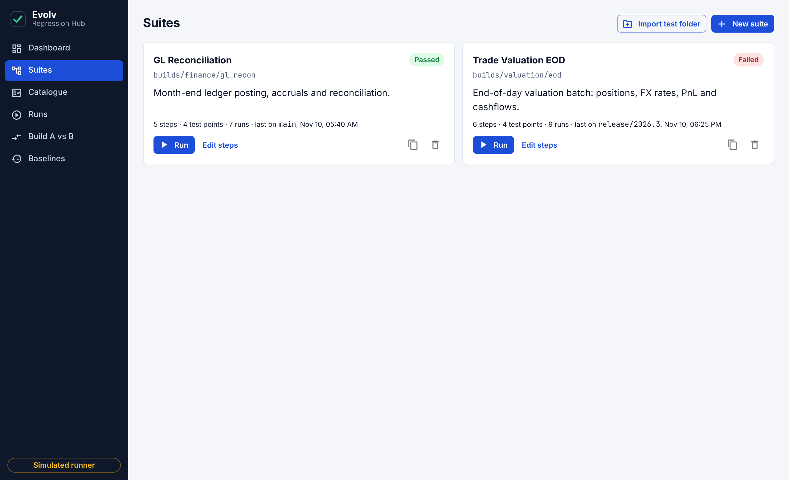

Each card is one suite. From a card you can:

- **Run** it.
- **Edit steps** to open the suite.
- Use the two icons on the right to **duplicate** or **delete** it. Deleting a suite also deletes
  its test points, baselines and runs, and cannot be undone.

### Import an existing build folder

This is the quickest way to bring in a regression you already run from the Excel driver.

1. On the Suites page click **Import test folder**.
2. Click **Choose folder** and pick the build folder, or **Choose zip** if you have it zipped.
   To try it out, use `samples/loan_accrual.zip` from the app's folder.
3. The Hub reads the folder and shows what it found.

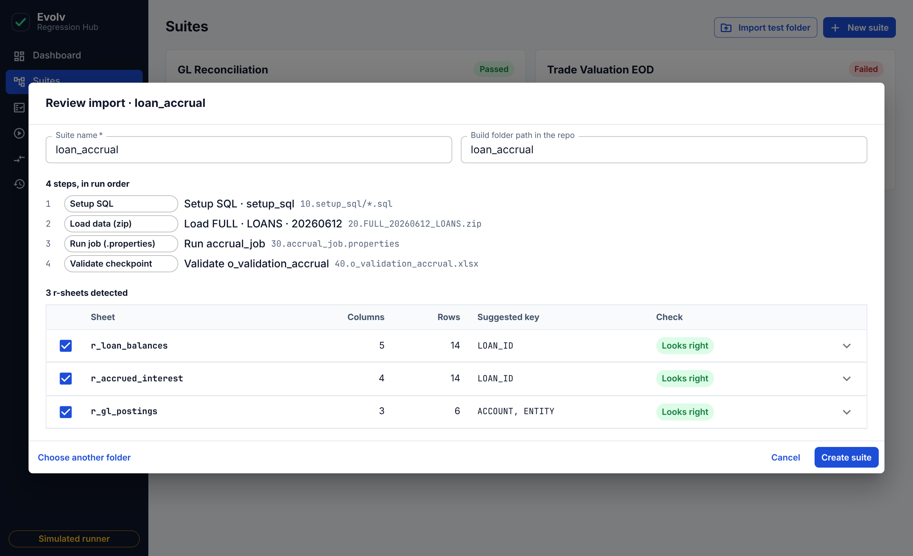

What the Hub does with each item in the folder:

| In the folder | Becomes |
| --- | --- |
| A sub-folder of `.sql` files | A setup SQL step |
| A `.zip` file | A data-load step |
| A `.properties` file | A run-job step |
| An `o_validation` Excel workbook | A validate step; every sheet whose name starts with `r` becomes a test point |

The number at the start of each name (`10.`, `20.`, …) sets the order of the steps.

4. Check the list of sheets. Each one shows its columns, rows and suggested key.
   - **Looks right** means it can be imported as is.
   - A **red label** names a problem, for example *No SQL found* or *Duplicate column names*.
     Click the arrow at the end of the row to fix it: change the **SQL row** or **Header row**
     number, or click column names to choose the **key columns**.
   - Untick the box at the start of a row to leave that sheet out.
5. Check the **Suite name**, then click **Create suite**. The button stays grey until every
   included sheet looks right.

The expected rows in each sheet become **version 1** of that test point's baseline. An import that
you start but do not finish is discarded after 24 hours.

### Edit a suite

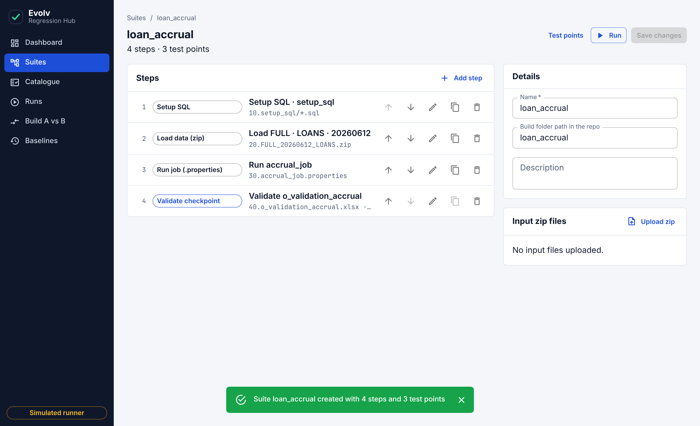

- **Add step** adds a step. The icons on each row move it **up** or **down**, **edit**,
  **duplicate** or **delete** it. Steps run from top to bottom.
- **Details** on the right holds the name, build folder path and description.
- **Input zip files** lets you upload the data zips the suite uses.
- Click **Save changes** when you are done. Step and detail edits are not saved until you do.

## 3. Catalogue

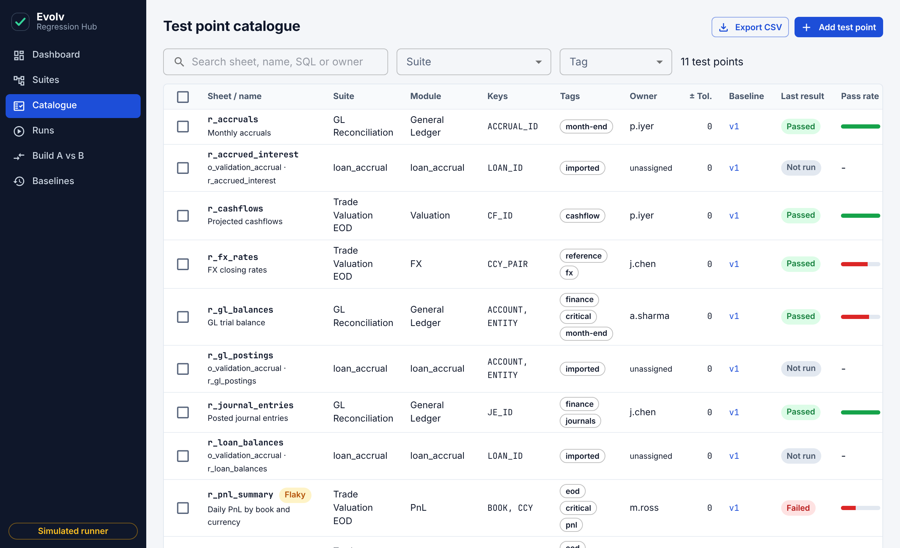

The catalogue lists every test point in every suite.

- **Search** looks in the sheet name, name, SQL and owner.
- Filter by **Suite** or **Tag**. Clicking a tag in the table filters by it.
- **Last result** and **Pass rate** show recent health. A **Flaky** label marks unreliable test points.
- **Baseline** shows the current version; click it to see that test point's baseline history.
- **Export CSV** downloads the list as you have filtered it.
- **Add test point** creates one by hand. The pencil and bin icons on each row edit or delete it.
- Tick several rows to **Edit selected** (owner, module, tolerance, tags) or **Delete selected**.

Three settings on a test point matter most:

| Setting | What it does |
| --- | --- |
| Key columns | How rows are matched between baseline and actual. With none, rows are matched by position. |
| Numeric tolerance (±) | Numeric differences up to this size are treated as equal. Use it for rounding noise. |
| Impacted-by paths | Code paths that affect this test point, such as `src/fx/`. Used by "Run only impacted tests". |

## 4. Start a run

1. Click **New run** (on the Dashboard or Runs page), or **Run** on a suite card.
2. Choose the **Suite** and the **Branch or release**.
3. Optional: switch on **Run only impacted tests**. The dialog lists the files changed on that
   branch and the test points they affect, and only those run. This is a quick check for a feature branch.
4. The dialog tells you how many test points will run. Click **Start run**.

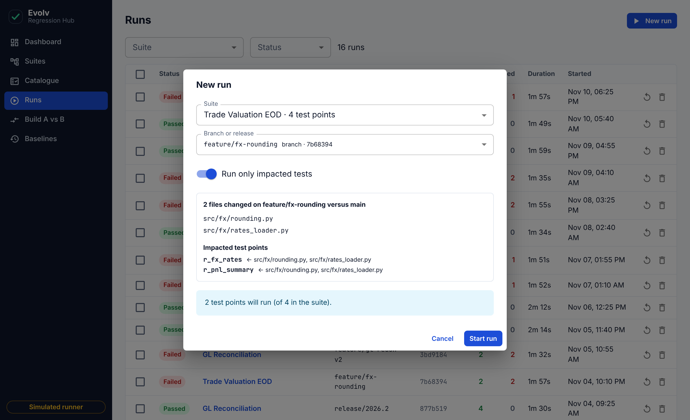

## 5. Watch a run

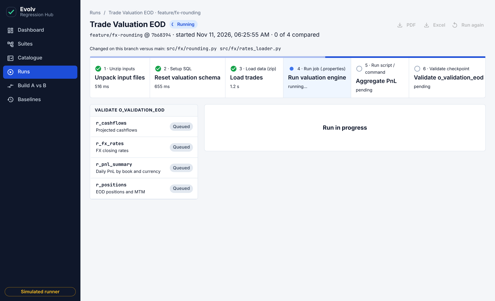

The run page updates by itself.

- The **row of boxes** is the suite's steps, in order. A green tick means done, a blue dot means
  running. Click a box to see that step's log.
- The **list on the left** is the test points. They are compared when their validate step is reached.

When the run finishes, its status at the top becomes **Passed** or **Failed**.

## 6. Find out why a test point failed

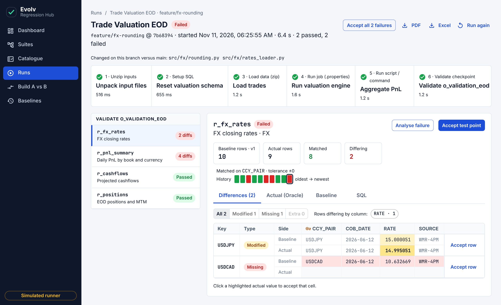

Failed test points are at the top of the list on the left, with the number of differing rows.
Click one to see the detail on the right.

- The four **number boxes** show baseline rows, actual rows, how many matched and how many differ.
- The **History** strip shows this test point's recent results, oldest to newest. Hover over a
  square for the branch and date; click it to open that run.
- The **Differences** tab shows each differing row twice: the **Baseline** line and the **Actual**
  line. Changed cells are highlighted.

| Label | Meaning |
| --- | --- |
| Modified | The row is on both sides but some values differ |
| Missing | The row is in the baseline but was not returned |
| Extra | The row was returned but is not in the baseline |

- Use the **All / Modified / Missing / Extra** buttons and the **column chips** above the grid to
  narrow down what you see.
- The **Actual (Oracle)**, **Baseline** and **SQL** tabs show the full result, the full baseline
  and the query.

### Ask for an AI explanation

Click **Analyse failure**. A panel opens on the right and writes a short analysis: a summary, the
patterns in the differences, the likely cause, a verdict and next steps. It uses the query, the
differences, the files changed on the branch and the test point's history.

This needs to be switched on by whoever set up the app. If it is not, the panel says so. Only the
failing rows are sent for analysis, never the full results. Treat the analysis as a suggestion and
check it against the differences yourself.

## 7. Accept a change as the new baseline

If a difference is **intended** (for example, an approved calculation change), accept it so that
future runs expect the new values. If it is **not intended**, do not accept it: it is a defect to
send back.

You can accept at four levels:

| To accept | Click |
| --- | --- |
| One cell | The highlighted value on the **Actual** line |
| One row | **Accept row** at the end of that row |
| A whole test point | **Accept test point** at the top right of the detail |
| Every failure in the run | **Accept all failures** at the top of the page |

Each time, a dialog asks for **your name** and a **reason**. Both are required and are kept
permanently in the baseline history.

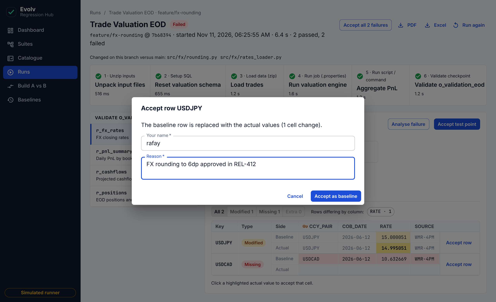

After you confirm, the result is compared again straight away. When no differences remain, the test
point turns green.

Accepting everything in a run is fast, but it also accepts anything you did not look at. Use it only
when you have reviewed the failures.

## 8. Baselines: history and undo

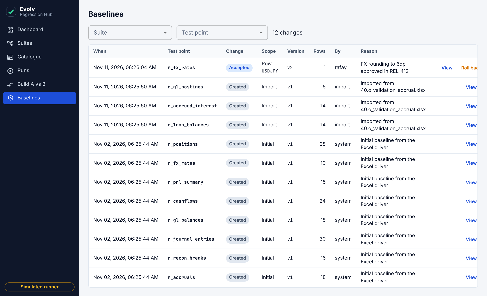

The Baselines page lists every baseline change: when, which test point, what kind of change, the
new version, who made it and why.

- Click **View** to see the before and after values of the rows that changed.

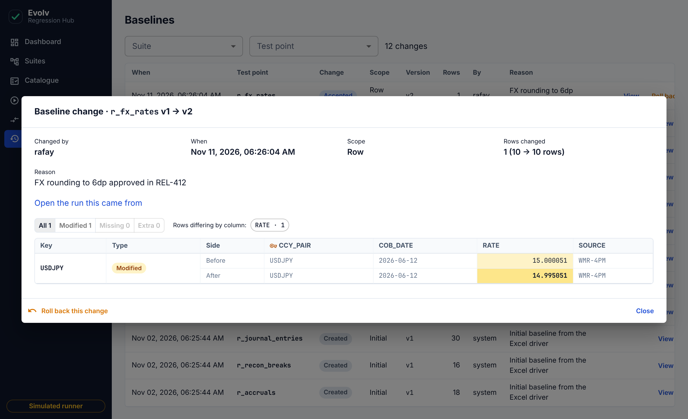

- Click **Roll back** to undo a change. Only the **most recent** change of each test point can be
  rolled back. You are asked for your name and a reason, and the rollback is itself added to the list.

Rolling back does not change the results of runs that already finished. Start a new run to see the
effect.

## 9. Build A vs B

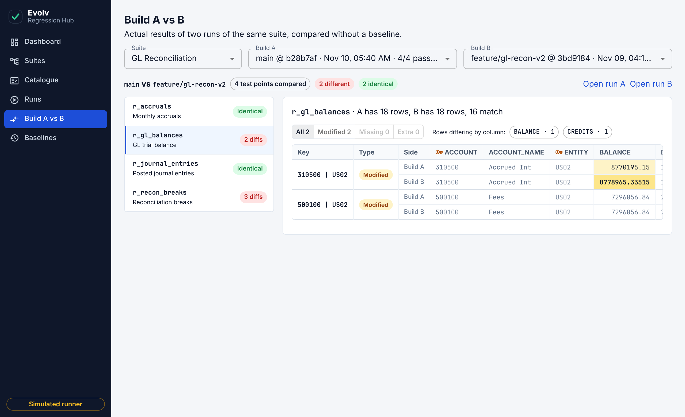

This compares the results of two runs with **each other**, ignoring the baseline. It is useful
before merging a branch: compare the branch with `main` to see exactly what your change alters.

1. Choose the **Suite**.
2. Choose **Build A** and **Build B** from that suite's finished runs.
3. The list on the left shows each test point as **Identical** or with its number of differences.
   Click one to see the rows, with Build A and Build B lines.

## 10. Reports for sign-off

Open a finished run and click **PDF** or **Excel** at the top right. The report lists failures
first, includes the differences, and ends with a sign-off block for a name, role and date.

## 11. Other things you can do with runs

On the **Runs** page:

- Filter by **Suite** or **Status**.
- The circular arrow **runs it again** on the same suite and branch.
- The bin **deletes** a run. Tick several rows to delete them together. Deleting runs does not
  change any baseline.

---

## Common questions

**A test point failed. What should I do?**
Open it and read the differences. If the change is expected, accept it with a clear reason. If it
is not, leave it failed and raise it with the developer; the report or the page link is your evidence.

**The same test point passes one time and fails the next.**
It is flaky. It will carry a **Flaky** label. Re-run to confirm, and tell the test point's owner;
do not accept a flaky difference as a baseline.

**Small decimal differences keep failing a test point.**
Set a **numeric tolerance** on it in the Catalogue (pencil icon).

**Rows come back in a different order and everything shows as different.**
The test point has no key columns, so rows are matched by position. Edit it in the Catalogue and
choose its key columns.

**I accepted something by mistake.**
Go to **Baselines**, find the change and click **Roll back**.

**Create suite is greyed out during an import.**
A sheet has a red label. Fix it or untick it.

**Analyse failure says it is not configured.**
AI analysis has not been switched on for this installation. Ask whoever set up the app.
