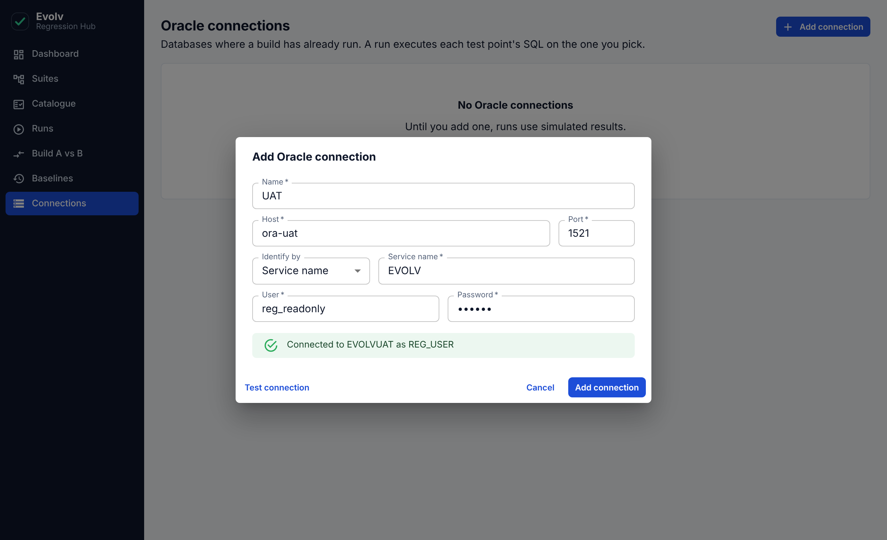
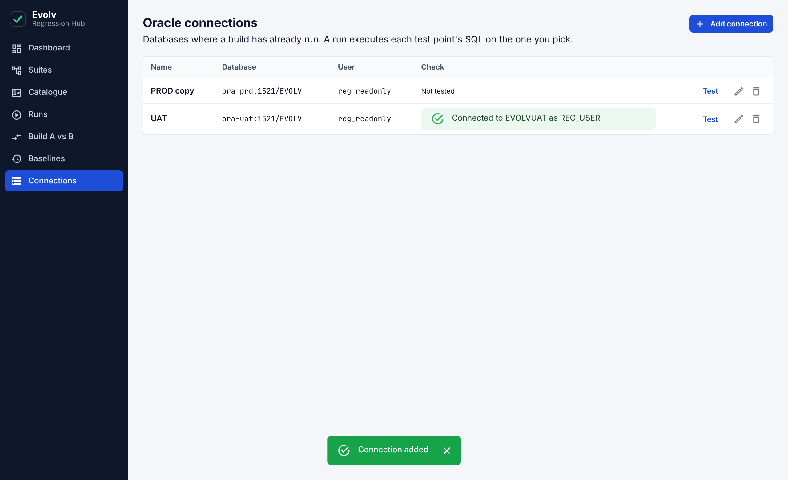
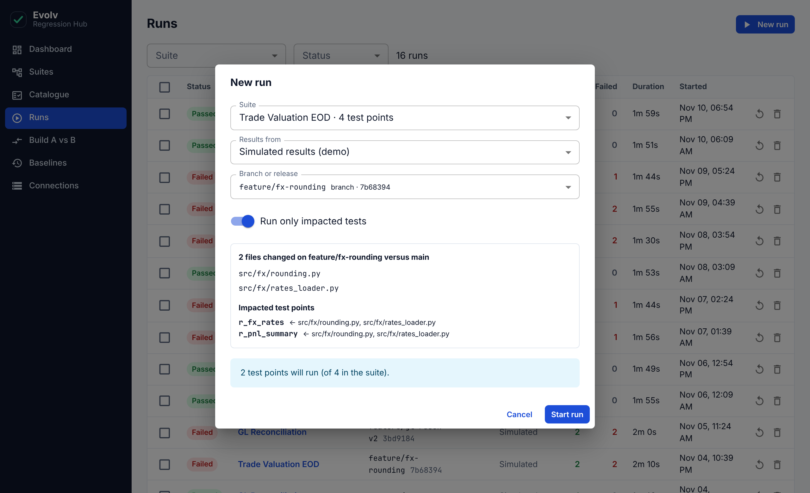
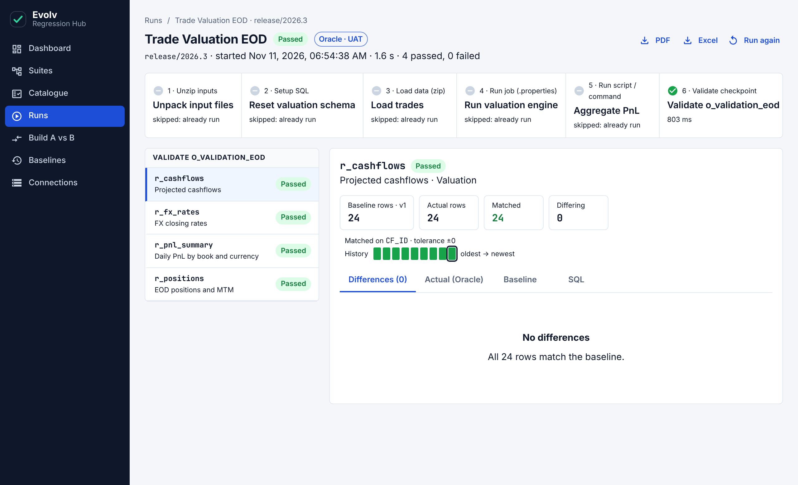
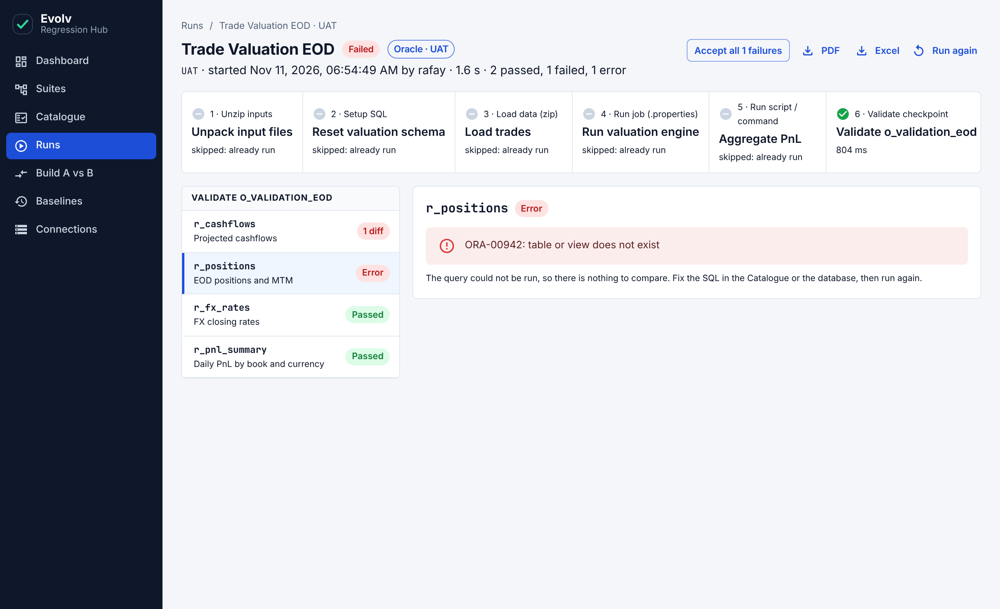
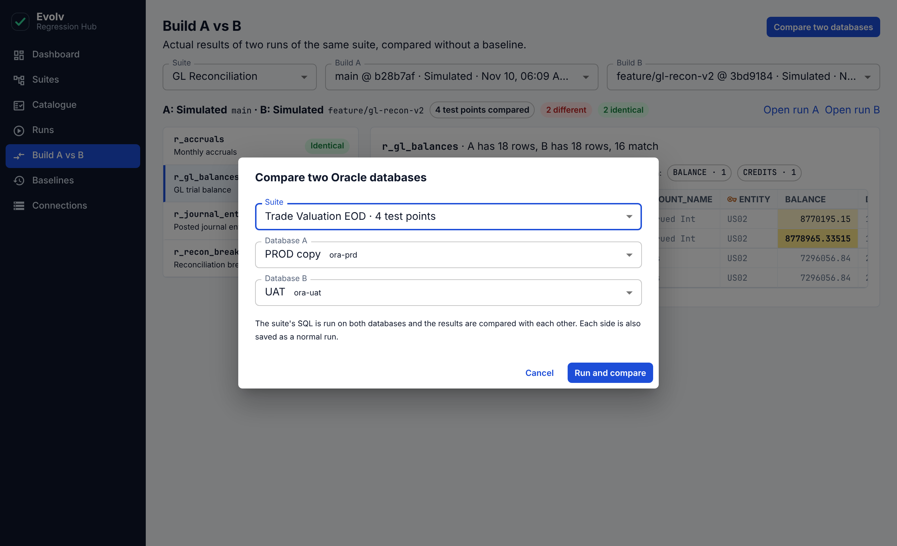
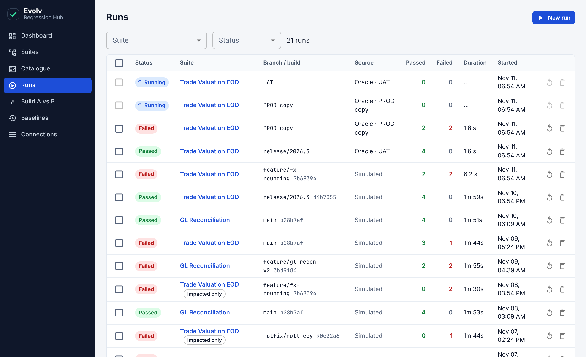

# Evolv Regression Hub: user guide

The Hub runs regression suites against a branch or release and compares every result with an
approved **baseline**. When something differs, it shows you the exact sheet, row and column, and
lets you either accept the change as the new baseline or treat it as a defect.

**Before you start, three things to know about this version:**

- **The Hub checks results; it does not run the build.** You point it at an Oracle database where
  the build has already run. It runs each test point's SQL there and compares what comes back with
  the baseline.
- **The Hub must be able to reach Oracle.** If your databases are only reachable over the company
  VPN, connect the VPN on the computer that runs the Hub before you test a connection or start a run.
- **There is no login.** Anyone who can open the app can use it, including the saved Oracle
  connections. When you change a baseline, you type your name and it is recorded.

The app also has **simulated results** for trying things out without a database. They are made up
and are always labelled **Simulated**.

To open the app, go to the address your team gave you (on your own computer: http://localhost:8000).

## Words used in the app

| Word | Meaning |
| --- | --- |
| Suite | One regression: an ordered list of steps plus the checks made at the end. It matches one build folder. |
| Step | One action in a suite, such as running setup SQL, loading a data zip or running a job. |
| Test point | One check: an Oracle query and the rows it is expected to return. It comes from one `r` sheet of a validation workbook. |
| Checkpoint | A "validate" step. It groups the test points from one validation workbook. |
| Baseline | The approved expected rows for a test point. Every change creates a new version (v1, v2, …). |
| Key columns | The columns that identify a row, such as a loan ID. Rows are matched on these, so row order never causes a failure. |
| Run | One check of a suite against one database (or one simulated branch). |
| Connection | The saved details of an Oracle database: host, port, service name, user and password. |
| Flaky | A test point that passes and fails on the same branch with the same baseline. |

## The menu

The dark bar on the left takes you to the seven areas of the app.

| Menu item | Use it to |
| --- | --- |
| Dashboard | See overall health at a glance |
| Suites | Create, import and edit suites |
| Catalogue | Find and manage test points |
| Runs | Start runs and open their results |
| Build A vs B | Compare two runs with each other |
| Baselines | See who changed a baseline, and undo a change |
| Connections | Add the Oracle databases that runs can query |

---

## 1. Dashboard

- The **boxes at the top** show totals: runs, pass rate, average duration, open failures, flaky
  test points, test points and baseline updates. **Open failures** counts what is still failing in
  the most recent run of each suite and branch.
- **Test points per run** shows green (passed) and red (failed) for each recent run. Click a bar to
  open that run.
- **Lowest pass rate** lists the test points that fail most often.
- **Recent runs** lists the latest runs. Click a row to open it.

## 2. Suites

Each card is one suite. From a card you can:

- **Run** it.
- **Edit steps** to open the suite.
- Use the two icons on the right to **duplicate** or **delete** it. Deleting a suite also deletes
  its test points, baselines and runs, and cannot be undone.

### Import an existing build folder

This is the quickest way to bring in a regression you already run from the Excel driver.

1. On the Suites page click **Import test folder**.
2. Click **Choose folder** and pick the build folder, or **Choose zip** if you have it zipped.
   To try it out, use `samples/loan_accrual.zip` from the app's folder.
3. The Hub reads the folder and shows what it found.

What the Hub does with each item in the folder:

| In the folder | Becomes |
| --- | --- |
| A sub-folder of `.sql` files | A setup SQL step |
| A `.zip` file | A data-load step |
| A `.properties` file | A run-job step |
| An `o_validation` Excel workbook | A validate step; every sheet whose name starts with `r` becomes a test point |

The number at the start of each name (`10.`, `20.`, …) sets the order of the steps.

4. Check the list of sheets. Each one shows its columns, rows and suggested key.
   - **Looks right** means it can be imported as is.
   - A **red label** names a problem, for example *No SQL found* or *Duplicate column names*.
     Click the arrow at the end of the row to fix it: change the **SQL row** or **Header row**
     number, or click column names to choose the **key columns**.
   - Untick the box at the start of a row to leave that sheet out.
5. Check the **Suite name**, then click **Create suite**. The button stays grey until every
   included sheet looks right.

The expected rows in each sheet become **version 1** of that test point's baseline. An import that
you start but do not finish is discarded after 24 hours.

### Edit a suite

- **Add step** adds a step. The icons on each row move it **up** or **down**, **edit**,
  **duplicate** or **delete** it. Steps run from top to bottom.
- **Details** on the right holds the name, build folder path and description.
- **Input zip files** lets you upload the data zips the suite uses.
- Click **Save changes** when you are done. Step and detail edits are not saved until you do.

## 3. Catalogue

The catalogue lists every test point in every suite. This is also where you edit a test point's
**SQL**: click the pencil on its row. The SQL you save here is what runs on Oracle.

- **Search** looks in the sheet name, name, SQL and owner.
- Filter by **Suite** or **Tag**. Clicking a tag in the table filters by it.
- **Last result** and **Pass rate** show recent health. A **Flaky** label marks a test point that
  passed and failed on the same build with the same baseline.
- **Baseline** shows the current version; click it to see that test point's baseline history.
- **Export CSV** downloads the list as you have filtered it.
- **Add test point** creates one by hand. The pencil and bin icons on each row edit or delete it.
- Tick several rows to **Edit selected** (owner, module, tolerance, tags) or **Delete selected**.

Three settings on a test point matter most:

| Setting | What it does |
| --- | --- |
| Key columns | How rows are matched between baseline and actual. With none, rows are matched by position. |
| Numeric tolerance (±) | Numeric differences up to this size are treated as equal. Use it for rounding noise. |
| Impacted-by paths | Code paths that affect this test point, such as `src/fx/`. Used by "Run only impacted tests" on simulated runs. |

## 4. Connections: tell the Hub about your Oracle databases

Do this once for each database you want to check, for example UAT and a production copy.

1. If your databases need the VPN, connect it first.
2. Open **Connections** and click **Add connection**.
3. Fill in the details. Your DBA or an existing SQL Developer connection has these values.

| Field | What to enter |
| --- | --- |
| Name | A short name you will recognise, such as `UAT` |
| Host | The database server's address |
| Port | Usually `1521` |
| Identify by | **Service name** in most cases; choose **SID** if that is what you were given |
| User and Password | The Oracle account to query with. A read-only account is safest. |

4. Click **Test connection**. A green message naming the database means it works. A red message
   says what is wrong, for example that the server could not be reached (check the VPN) or that
   the user name or password was rejected.
5. Click **Add connection**.

The list shows every saved connection. **Test** checks one again, the pencil edits it, the bin
deletes it. When you edit a connection, leave the password empty to keep the saved one.

The password is saved so that you do not have to type it for every run. It is never shown again in
the app. It is stored in the Hub's own database, so use an account that can only read.

## 5. Start a run

1. Click **New run** (on the Dashboard or Runs page), or **Run** on a suite card.
2. Choose the **Suite**.
3. In **Results from**, choose the Oracle connection to check. The Hub remembers your choice for next time.
4. Optional: type a **Build label** saying what is loaded on that database, for example
   `release/2026.3`. It appears in the run list and in reports. Left empty, the connection name is used.
5. Click **Start run**.

What happens next:

- The Hub connects to the database.
- For every test point in the suite it runs the SQL exactly as written and collects the rows.
- It compares those rows with the test point's baseline.

Things to know about the SQL:

- Only queries are run: statements that start with `SELECT` or `WITH`. Anything else is refused.
- Values must be written into the query. Placeholders such as `:cob_date` are not filled in.
- A trailing semicolon is fine; the Hub removes it.
- Results are compared up to 5,000 rows. A query that returns more is reported as an error.
- The columns the query returns should match the test point's columns. If the names match they are
  lined up by name, otherwise by position.

### Trying it without a database

In **Results from**, choose **Simulated results (demo)** and pick a branch. Nothing is queried; the
results are made up so that you can practise. With **Run only impacted tests** switched on, only the
test points linked to the files changed on that branch run.

## 6. Watch a run

The run page updates by itself. The label next to the status shows where the results came from:
**Oracle** and the connection name, or **Simulated**.

- The **row of boxes** is the suite's steps. On an Oracle run the build steps show
  **skipped: already run**, because the build was done before you started; only the validate step
  runs. Click a box to see its log.
- The **list on the left** is the test points, each ending as **Passed**, a number of **diffs**, or **Error**.

On a simulated run the build steps are played through one after another:

When the run finishes, its status at the top becomes **Passed** or **Failed**.

### If a query could not be run

A test point shows **Error** when Oracle rejected its query, for example because a table name is
wrong. Click it to read Oracle's message. The other test points are not affected.

Fix the SQL in the **Catalogue** (pencil icon on the test point), or fix the database, then use
**Run again**. An error is not a difference, so there is nothing to accept.

### If the whole run stopped

If the database cannot be reached, the run stops straight away with a red message such as
*Could not reach host:1521. Check that the VPN is connected*. Connect the VPN, check the connection
on the **Connections** page with **Test**, then use **Run again**.

## 7. Find out why a test point failed

Failed test points are at the top of the list on the left, with the number of differing rows.
Click one to see the detail on the right.

- The four **number boxes** show baseline rows, actual rows, how many matched and how many differ.
- The **History** strip shows this test point's recent results, oldest to newest. Hover over a
  square for the branch and date; click it to open that run.
- The **Differences** tab shows each differing row twice: the **Baseline** line and the **Actual**
  line. Changed cells are highlighted.

| Label | Meaning |
| --- | --- |
| Modified | The row is on both sides but some values differ |
| Missing | The row is in the baseline but was not returned |
| Extra | The row was returned but is not in the baseline |

- Use the **All / Modified / Missing / Extra** buttons and the **column chips** above the grid to
  narrow down what you see.
- The **Actual (Oracle)**, **Baseline** and **SQL** tabs show everything the query returned, the
  full baseline and the query itself.

### Ask for an AI explanation

Click **Analyse failure**. A panel opens on the right and writes a short analysis: a summary, the
patterns in the differences, the likely cause, a verdict and next steps. It uses the query, the
differences and the test point's history.

This needs to be switched on by whoever set up the app. If it is not, the panel says so. Only the
failing rows are sent for analysis, never the full results. Treat the analysis as a suggestion and
check it against the differences yourself.

## 8. Accept a change as the new baseline

If a difference is **intended** (for example, an approved calculation change), accept it so that
future runs expect the new values. If it is **not intended**, do not accept it: it is a defect to
send back.

You can accept at four levels:

| To accept | Click |
| --- | --- |
| One cell | The highlighted value on the **Actual** line |
| One row | **Accept row** at the end of that row |
| A whole test point | **Accept test point** at the top right of the detail |
| Every failure in the run | **Accept all failures** at the top of the page |

Each time, a dialog asks for **your name** and a **reason**. Both are required and are kept
permanently in the baseline history.

After you confirm, the result is compared again straight away. When no differences remain, the test
point turns green.

Accepting everything in a run is fast, but it also accepts anything you did not look at. Use it only
when you have reviewed the failures.

## 9. Baselines: history and undo

The Baselines page lists every baseline change: when, which test point, what kind of change, the
new version, who made it and why.

- Click **View** to see the before and after values of the rows that changed.

- Click **Roll back** to undo a change. Only the **most recent** change of each test point can be
  rolled back. You are asked for your name and a reason, and the rollback is itself added to the list.

Rolling back does not change the results of runs that already finished. Start a new run to see the
effect.

## 10. Build A vs B: compare two databases

This compares two sets of results with **each other**, ignoring the baseline. Use it to see exactly
how one database differs from another, for example UAT against a production copy, or the same
environment before and after a release.

### Compare two Oracle databases

1. Open **Build A vs B** and click **Compare two databases**.
2. Choose the **Suite**, then **Database A** and **Database B**.
3. Click **Run and compare**.

The Hub runs the suite's SQL on both databases. The page shows a waiting message with progress, then
the comparison:

- The line at the top says how many test points were compared, how many are **different** and how
  many are **identical**.
- The list on the left shows each test point. Click one to see its rows, with a **Build A** line and
  a **Build B** line and the changed cells highlighted.
- If a query failed on either database, that test point is listed in a yellow note and left out of
  the comparison. Use **Open run A** or **Open run B** to read the error.

Each side is also saved as a normal run, so you can open it from the **Runs** page and see how that
database compares with the baseline.

### Compare two runs you already have

Use the **Build A** and **Build B** boxes at the top to pick any two runs of the same suite. The
comparison appears straight away; nothing is run again.

## 11. Reports for sign-off

Open a finished run and click **PDF** or **Excel** at the top right. The report names the database
the results came from, lists failures first, includes the differences, and ends with a sign-off
block for a name, role and date.

## 12. Other things you can do with runs

On the **Runs** page:

- The **Source** column shows which database each run used.
- Filter by **Suite** or **Status**.
- The circular arrow **runs it again** on the same suite and database.
- The bin **deletes** a run. Tick several rows to delete them together. Deleting runs does not
  change any baseline.

---

## Common questions

**A run stopped with "Could not reach ... Check that the VPN is connected".**
The computer running the Hub cannot see the database. Connect the VPN, go to **Connections**, click
**Test** on that connection, and when it turns green use **Run again** on the run.

**A test point shows Error instead of Passed or Failed.**
Oracle could not run its query. Click the test point to read the message, fix the SQL in the
Catalogue, and run again.

**My query uses `:cob_date` and fails with a "not all variables bound" error.**
The Hub does not fill in placeholders. Edit the test point's SQL and write the value in.

**A brand new test point fails on its first run.**
If you created it by hand without pasting expected rows, its first baseline is only sample data.
Run it against a database you trust, check the result, then use **Accept test point** to make those
rows the baseline.

**A test point failed. What should I do?**
Open it and read the differences. If the change is expected, accept it with a clear reason. If it
is not, leave it failed and raise it with the developer; the report or the page link is your evidence.

**The same test point passes one time and fails the next.**
It is flaky. It will carry a **Flaky** label. Re-run to confirm, and tell the test point's owner;
do not accept a flaky difference as a baseline.

**Small decimal differences keep failing a test point.**
Set a **numeric tolerance** on it in the Catalogue (pencil icon).

**Rows come back in a different order and everything shows as different.**
The test point has no key columns, so rows are matched by position. Edit it in the Catalogue and
choose its key columns.

**I accepted something by mistake.**
Go to **Baselines**, find the change and click **Roll back**.

**Create suite is greyed out during an import.**
A sheet has a red label. Fix it or untick it.

**Analyse failure says it is not configured.**
AI analysis has not been switched on for this installation. Ask whoever set up the app.
